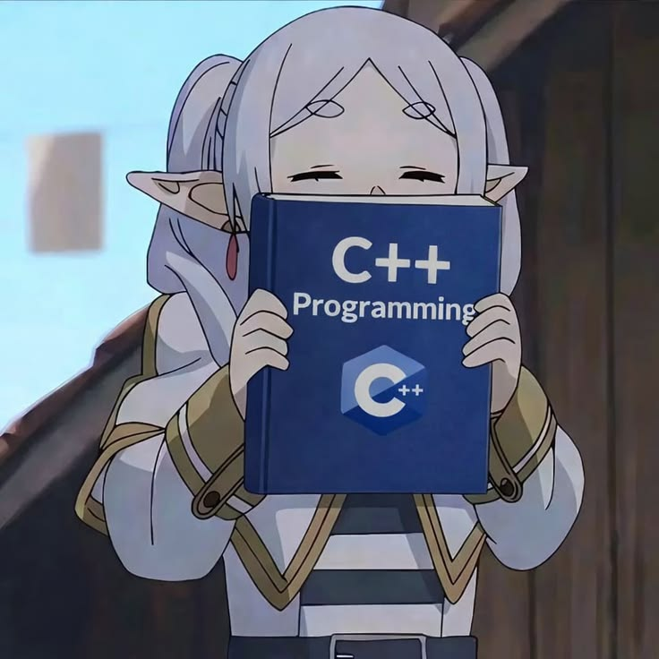

<!---
Show profile views
-->

  

  

segected@github

💻 Building games with Unreal Engine 5 & Blueprints, and apps in Python

🌱 Exploring server automation, VPN scripts, and the digital world

⚡ Tech stack: Python, Unreal Engine, PowerShell, Git

🎧 Always coding with great music in the background

  

 

<h2 align="center"> 🚀 🇲‌🇾‌ 🇵‌🇷‌🇴‌🇯‌🇪‌🇨‌🇹‌🇸‌ </h2>

  

<table>
  <tr>
    <!-- Projects / Scripts -->
    <td valign="top">
      <h3>📘 𝗣𝗿𝗼𝗷𝗲𝗰𝘁𝘀 & 𝗧𝗼𝗼𝗹𝘀</h3>
      <ul>
        <li>🛠️ <a href="https://github.com/segected/vpn-installer"><b>VPN-Installer</b></a>: 3x-ui + VLESS XHTTP Reality + AmneziaWG</li>
        <li>🎮 <b>UE5 Games</b>: Blueprints & indie development</li>
        <li>🐍 <b>Python Apps</b>: Automation scripts & utilities</li>
      </ul>
    </td>
    <!-- Tech & Focus -->
    <td valign="top">
      <h3>📗 𝗙𝗼𝗰𝘂𝘀</h3>
      <ul>
        <li>⚡ <b>System Automation</b>: PowerShell & Bash scripts</li>
        <li>🌐 <b>Networking</b>: VPN protocols & server setup</li>
      </ul>
    </td>
  </tr>
</table>

<h2 align="center"> 🇨‌🇴‌🇳‌🇹‌🇦‌🇨‌🇹‌ 🇲‌🇪‌ </h2>

  

 

  𝙵𝚎𝚎𝚕 𝚏𝚛𝚎𝚎 𝚝𝚘 𝚛𝚎𝚊𝚌𝚑 𝚘𝚞𝚝 ૮๑•̀ㅁ•́ฅა
   
  𝙹𝚞𝚜𝚝 𝚙𝚘𝚔𝚎 𝚖𝚎 𝚊𝚐𝚊𝚒𝚗 𝚒𝚏 𝙸 𝚏𝚘𝚛𝚐𝚎𝚝 𝚝𝚘 𝚛𝚎𝚙𝚕𝚢 ( ´ㅁ` ; )
   
   
  ❀˚✿˖°❀˖°✿˖❀˖°
   

 

<!---
Generate top languages
-->

  

